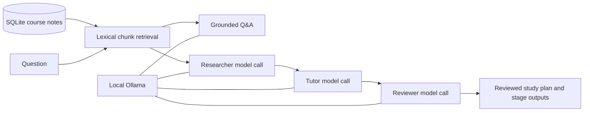

# Local AI Bootcamp Tutor

A Java 21 application with a browser chatbot, persistent SQLite conversations,
local course-note retrieval, and a three-agent study-plan workflow. All model
calls use local Ollama. No cloud provider or API key is required.

## Requirements and setup

- JDK 21 or later; check `java -version` and set `JAVA_HOME` to that JDK.
- Ollama for your OS: [official installation](https://ollama.com/download).
- Maven is included through `./mvnw` (first build downloads Maven and libraries).

On Linux, the official installer is:

```sh
curl -fsSL https://ollama.com/install.sh | sh
ollama --version
```

Start Ollama if the installer/app has not already started it. Keep this terminal
open, or use your OS's Ollama service:

```sh
ollama serve
```

In another terminal:

```sh
ollama pull gemma3:1b
ollama run gemma3:1b 'In one sentence, what is Java?'
curl http://localhost:11434/api/tags
```

This workspace also has an official project-local Linux runtime under
`.local/ollama/`, with downloaded models under `.local/ollama/models/`.
Use `./scripts/ollama.sh` in place of `ollama` for that installation:

```sh
./scripts/ollama.sh --version
./scripts/ollama.sh serve  # only if the local API is not already running
```

The runtime and model files are ignored and are not part of the source project.
On a fresh checkout, install Ollama using the instructions above. To reproduce a
project-local Linux x86_64 install instead:

```sh
mkdir -p .local/downloads .local/ollama
curl -fL https://ollama.com/download/ollama-linux-amd64.tar.zst \
  -o .local/downloads/ollama-linux-amd64.tar.zst
tar --zstd -xf .local/downloads/ollama-linux-amd64.tar.zst -C .local/ollama
./scripts/ollama.sh serve
# In another terminal: ./scripts/ollama.sh pull gemma3:1b
```

Run the application from the project root:

```sh
# Optional: cp .env.example .env
./mvnw spring-boot:run
```

Open [http://localhost:8080](http://localhost:8080). Create a chat and send a
message. The browser sends it to the local model through the Spring application.


## Configuration

Defaults work without a `.env` file. Optional overrides are in `.env.example`;
the dotenv integration loads `.env` at startup.

| Variable | Default | Purpose |
| --- | --- | --- |
| `OLLAMA_BASE_URL` | `http://localhost:11434` | Local Ollama API |
| `OLLAMA_MODEL` | `gemma3:1b` | Downloaded local chat model |
| `AI_SYSTEM_PROMPT` | Concise English Java tutor | Normal chat instruction |
| `SQLITE_DB_PATH` | `chatbot.db` | Conversation and course-note database |
| `SERVER_PORT` | `8080` | Application HTTP port |

To use `llama3.2`, first run `ollama pull llama3.2`, then set
`OLLAMA_MODEL=llama3.2`. Model auto-pulling at application startup is disabled.
The app can start without Ollama; a generation request then returns HTTP 502
with an actionable message. Inference uses a 5-second connect timeout,
180-second read timeout, and no automatic retries.

## API examples

The existing browser interface is for ordinary chat. The tutor and knowledge
features are available through the additional REST endpoints below.

Create a chat, then use its returned `id`:

```sh
curl -sS -X POST http://localhost:8080/api/chats \
  -H 'Content-Type: application/json' -d '{"title":"Java practice"}'

curl -sS -X POST http://localhost:8080/api/chats/CHAT_ID/messages \
  -H 'Content-Type: application/json' \
  -d '{"content":"Explain constructor injection in one paragraph."}'
```

`POST /api/chats/{id}/chatMessages` remains supported. The response contains the
whole conversation, including the new `ASSISTANT` message. The model receives
the system instruction and ordered history on every exchange.

| Method | Endpoint | Result |
| --- | --- | --- |
| POST | `/api/chats` | Create chat; optional title; 201 |
| GET | `/api/chats` | List chats and message counts |
| GET | `/api/chats/{id}` | Read conversation |
| DELETE | `/api/chats/{id}` | Delete conversation and messages; 204 |
| POST | `/api/chats/{id}/messages` | Send message and persist reply |
| GET | `/api/knowledge/documents` | List stored course notes |
| GET | `/api/knowledge/documents/{id}` | Read one course note |
| POST | `/api/knowledge/documents` | Add a note; 201 |
| DELETE | `/api/knowledge/documents/{id}` | Remove note and search evidence; 204 |
| GET | `/api/knowledge/search?query=java&limit=3` | Retrieve ranked source chunks |
| POST | `/api/tutor/ask` | Answer using retrieved course notes |
| POST | `/api/tutor/study-plan` | Run researcher, tutor, reviewer |

Four bundled notes are seeded when the database is empty: Java fundamentals,
Spring Boot, JPA transactions, and Ollama/Spring AI. Add your own notes:

```sh
curl -sS -X POST http://localhost:8080/api/knowledge/documents \
  -H 'Content-Type: application/json' \
  -d '{"title":"Workshop schedule","content":"The Java workshop starts at 09:30 in room Orion."}'

curl -sS 'http://localhost:8080/api/knowledge/search?query=workshop&limit=3'

curl -sS -X POST http://localhost:8080/api/tutor/ask \
  -H 'Content-Type: application/json' \
  -d '{"question":"When does the Java workshop start?"}'
```

The answer response has `answer` and `sources`. Each source contains `id`,
`documentId`, `title`, `content`, and `score`. Prompts ask the model to cite the
source IDs in square brackets. With no matching notes, the endpoint returns a
clear no-evidence answer and does not invoke the model.

```sh
curl -sS -X POST http://localhost:8080/api/tutor/study-plan \
  -H 'Content-Type: application/json' \
  -d '{"topic":"Java records","level":"BEGINNER","days":2}'
```

`level` must be `BEGINNER`, `INTERMEDIATE`, or `ADVANCED`; `days` must be 1–7.
The result has `plan`, `stages` (named `agent` and `output`), and `sources`.
`plan` is the reviewer's complete corrected plan.

## Retrieval and multi-agent workflow



The researcher extracts facts and prerequisites. The tutor uses those findings
and the retrieved excerpts to draft daily exercises. The reviewer receives the
draft, research, and sources and produces the final plan. These are three
separate Spring AI calls with separate system roles, using the same local model.
Each stage must succeed before the next starts; failures return 502 instead of a
partial plan. No simulated agents or hidden cloud fallback are used.

Retrieval splits notes into at most 900-character chunks with 100-character
overlap. It ranks matching terms, boosts title matches, filters common stop
words, and uses stable source IDs to break ties. Up to three chunks enter each
tutor prompt. Retrieved text and agent outputs are framed as reference data.

This is **lexical RAG**, so synonyms without shared terms can be missed. No
embedding model, vector database, MCP process, or tool-calling support is
required. Study plans without matching notes are labeled general guidance.
Small-model output remains probabilistic: citation accuracy and exercise quality
should be checked against returned excerpts. Normal chat sends the full history;
very long conversations may exceed the configured 4096-token model context.

SQLite is suitable for this local demo. Chat generation runs inside a transaction
so the user message, reply, and generated title roll back together on failure;
this holds a database connection while the model runs and limits concurrency.
Tutor generation does not hold a database transaction. The app binds to loopback
and is intended for local use.

## Tests and acceptance

```sh
./mvnw verify                 # No running model required
./mvnw -Pollama-live verify   # Requires Ollama + configured model
node --test src/test/js/app.test.cjs  # Optional browser regression tests; Node 20+
```

Normal tests exercise the real Spring AI HTTP integration against a controlled
local Ollama-protocol fixture, plus isolated SQLite persistence and tutor unit
tests. They cover ordered history, rollback, empty replies, CRUD, validation,
retrieval, no-evidence behavior, and all three stage handoffs.

The standalone browser tests use Node's built-in test runner, with no npm
dependencies. They cover late model replies, switching/deleting chats while a
request is pending, and preserving drafts on failure. Node is not required to
build or run the Java application.

The opt-in live acceptance test starts the application on a random port, makes
a real chat request, checks a fact from a newly inserted note, and runs all three
agents against actual local Ollama. Its database is separate from your data.

To verify an already running app and save its generated outputs:

```sh
python3 scripts/smoke-test.py
# Optional: --base-url http://localhost:8080 --output .local/acceptance.json
```

The script removes its temporary chat and writes a transcript for inspection.
If the model is missing, run `ollama pull gemma3:1b`. If generation returns 502,
check `curl http://localhost:11434/api/tags` and the application/Ollama logs.
If port 8080 is occupied, set `SERVER_PORT=8081` and use that port in requests.

The [implementation plan](docs/superpowers/plans/2026-10-29-local-ollama-tutor.md)
and [design](docs/superpowers/specs/2026-10-29-local-ollama-tutor-design.md) record
the assignment mapping and decisions. Dependency compatibility follows the
[Spring AI getting-started guide](https://docs.spring.io/spring-ai/reference/getting-started.html);
the native integration follows the
[Ollama chat guide](https://docs.spring.io/spring-ai/reference/api/chat/ollama-chat.html).

Verified on October 29, 2026 with Java 21, Ollama 0.40.13, and `gemma3:1b`:
16 ordinary tests, four browser regression tests, and the real-model acceptance
test passed. The packaged-app smoke test also passed. All six original TODOs
are implemented; the former OpenRouter stubs have been replaced with the local
Ollama integration.
